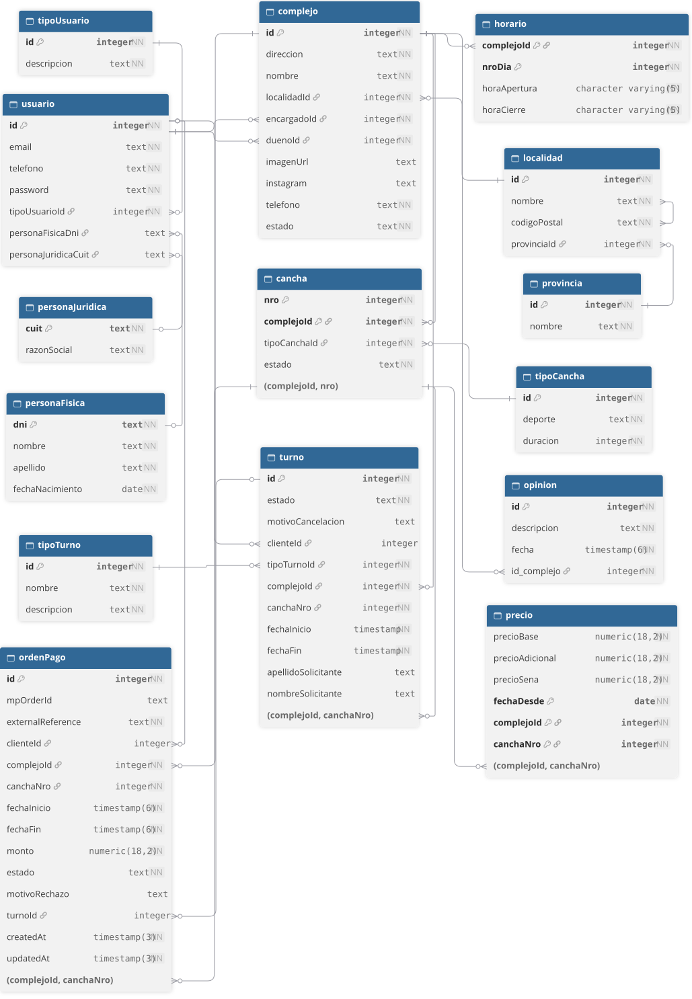

# Propuesta TP DSW

## Grupo

### Integrantes

- 53786, Ondategui, Mateo.
- 54153, Lagostina, Lautaro Antolin
- 55027, Surjak, Mirko.

### Repositorios

- [frontend app](https://github.com/MateoSr/frontend)
- [backend app](https://github.com/MateoSr/backend)

### Links

- [link del video](https://youtu.be/HndhDLwAeFQ)
- [sitio web](https://frontend-ganga21.vercel.app)
- Documentación de la API: Swagger UI, publicada por el backend (ver `src/docs` y `src/config/swagger.ts`)

### Stack

| Capa | Tecnologías |
| --- | --- |
| Frontend | React 19, Vite, React Router 7, Axios |
| Backend | Node.js, TypeScript, Express 5 |
| Datos | PostgreSQL, Prisma 7, validación con Zod |
| Servicios externos | Mercado Pago (pagos), Brevo (emails), Cloudinary (imágenes) |
| Seguridad | JWT, bcrypt, control de acceso por rol, firma HMAC en webhooks |
| Calidad | Vitest, Supertest, Testing Library, Playwright (e2e) |

## Tema

### Descripción

Turno Libre es un sistema para la gestión de alquileres de canchas de distintos deportes. Los Clientes pueden buscar complejos con turnos disponibles (por ciudad, deporte, fecha, hora y precio), reservar una cancha, pagar la seña online con Mercado Pago, consultar y cancelar sus turnos y dejar opiniones sobre los complejos. El Encargado opera el complejo que tiene asignado y agenda turnos para clientes que reservan por fuera de la plataforma. El Dueño configura sus complejos (horarios, canchas y precios) y accede a un panel con métricas de su negocio. El Administrador gestiona usuarios, personas y complejos.

### Roles

| Rol | Alcance |
| --- | --- |
| Administrador | Gestiona usuarios, personas físicas y jurídicas, y complejos (alta, baja y modificación). |
| Dueño | Configura sus complejos, horarios, canchas y precios. Ve métricas del día en su panel. |
| Encargado | Ve los turnos de su complejo y agenda turnos para solicitantes que no tienen cuenta. |
| Cliente | Busca, reserva, paga la seña, consulta y cancela sus turnos y opina sobre los complejos. |

### Modelo

Respecto de la propuesta original, el modelo de dominio cambió. Los distintos tipos de usuario (Cliente, Encargado, Dueño, Administrador) quedaron unificados en una única entidad `Usuario` que se diferencia por su `TipoUsuario`, y se sumó `OrdenPago` para soportar el cobro con Mercado Pago. El esquema vigente está en [`prisma/schema.prisma`](https://github.com/MateoSr/backend/blob/main/prisma/schema.prisma) y se resume en este diagrama:

  
   
  <em>Diagrama de Modelo de Dominio</em>

Principales decisiones de modelado:

- `Cancha` tiene clave compuesta (`complejoId`, `nro`) y `Precio` tiene clave compuesta (`complejoId`, `canchaNro`, `fechaDesde`), de modo que cada cancha conserva su historial de precios (precio base, adicional y seña).
- `Horario` define apertura y cierre de un complejo por día de la semana.
- `TipoCancha` define el deporte y la duración del turno.
- `Turno` guarda fecha de inicio y fin, y puede tener `cliente` (usuario registrado) o datos del solicitante (nombre y apellido) cuando lo agenda un encargado. Su estado avanza automáticamente (`Reservado`, `En curso`, `Finalizado`) o termina en `Cancelado`.
- `OrdenPago` registra el cobro de la seña en Mercado Pago (pendiente, aprobada, cancelada, expirada, rechazada o reembolsada).
- `Opinion` queda asociada al complejo.

## Alcance Funcional

### Alcance Mínimo

Regularidad:

| Req | Detalle |
| --- | --- |
| CRUD simple | 1. CRUD Usuario (cubre Encargado, Dueño, Cliente y Administrador, según su Tipo de Usuario) 2. CRUD Complejo 3. CRUD Persona Física y CRUD Persona Jurídica |
| CRUD dependiente | 1. CRUD Cancha {depende de} CRUD Complejo 2. CRUD Horario {depende de} CRUD Complejo 3. CRUD Precio {depende de} CRUD Cancha (alta y consulta del historial) |
| Listado + detalle | 1. Listado de complejos que poseen turnos disponibles en un determinado horario para un deporte (búsqueda con filtros), con detalle del complejo y grilla de disponibilidad por cancha y fecha. 2. Listado de turnos de un complejo para el Dueño y el Encargado |
| CUU/Epic | 1. Reservar un turno de una cancha en un horario, con pago de seña por Mercado Pago |

Adicionales para Aprobación

| Req | Detalle |
| --- | --- |
| CRUD | 1. CRUD Usuario (Encargado, Dueño, Cliente, Administrador) 2. CRUD Complejo 3. CRUD Cancha 4. CRUD Horario 5. CRUD Precio (alta y consulta) 6. CRUD Persona Física 7. CRUD Persona Jurídica 8. CRUD Turno |
| CUU/Epic | 1. Reservar un turno de una cancha en un horario 2. Realizar una opinión del complejo 3. Cancelar una reserva (cliente) 4. Agendar un turno para un solicitante (encargado) 5. Registro, inicio de sesión y recuperación de contraseña |

### Alcance Adicional Voluntario

*Nota*: El Alcance Adicional Voluntario es opcional, pero ayuda a que la funcionalidad del sistema esté completa y será considerado en la nota en función de su complejidad y esfuerzo.

| Req | Detalle |
| --- | --- |
| Listados | 1. Listado de turnos de un complejo (Dueño y Encargado) 2. Listado de turnos propios del cliente ("Mis reservas") |
| CUU/Epic | 1. Cancelación de reserva por el cliente 2. Cobro de la seña con Mercado Pago: orden de pago, bloqueo temporal de la cancha, webhook firmado, liberación automática si el pago no llega en 10 minutos y reembolso automático ante solapamientos 3. Panel del Dueño con métricas del día (ocupación, ingresos estimados, capacidad y deporte estrella) |
| Otros | 1. Envío de emails transaccionales con Brevo: recuperación de contraseña, comprobante de reserva y avisos de contacto 2. Carga de imágenes de complejos con Cloudinary 3. Actualización automática de estados de los turnos (tarea programada cada 10 minutos) 4. Formulario de contacto para solicitar la contratación del servicio 5. Documentación de la API con Swagger 6. Tests automatizados (unitarios, de integración y e2e) 7. Control de acceso por rol en backend y frontend, y expiración de sesión |

